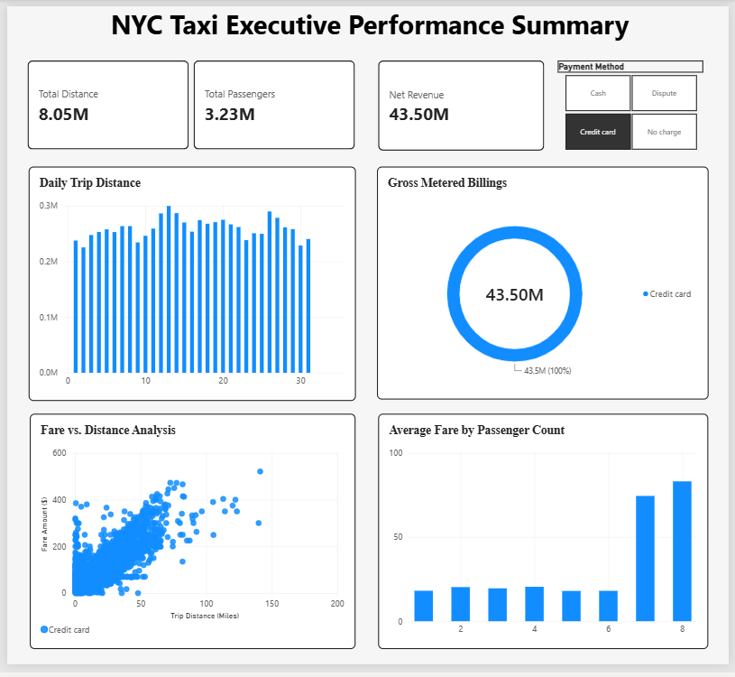
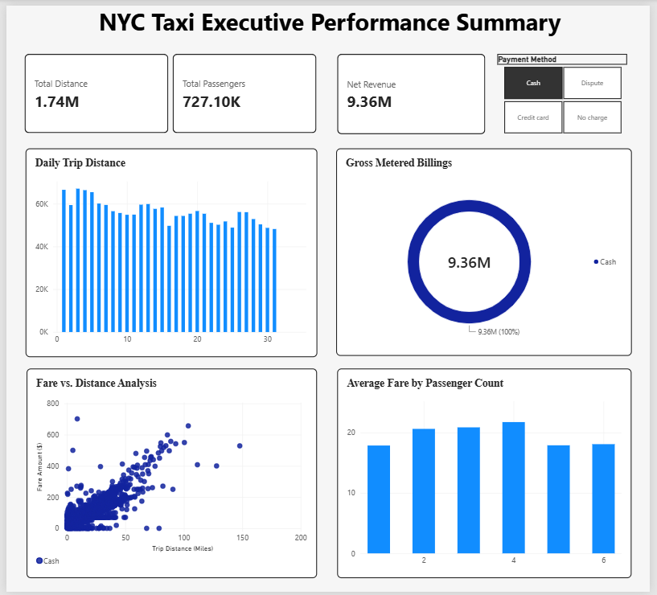
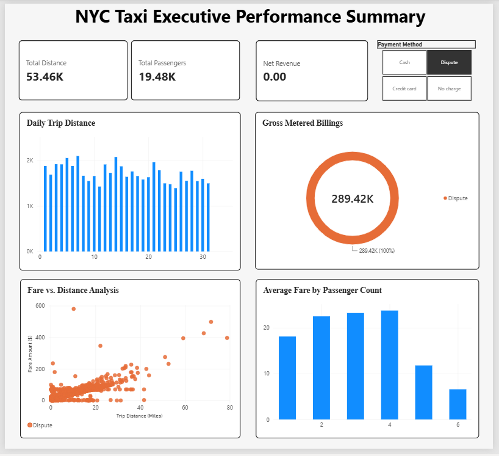
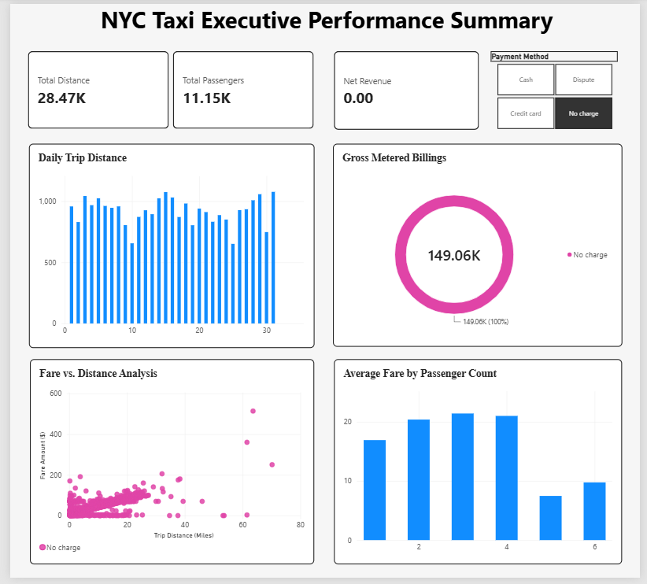

# NYC Yellow Taxi Analytics: High-Performance DuckDB Pipeline

## Executive Summary
An end-to-end data engineering and business intelligence project processing over 3.9 million New York City Yellow Taxi trip records for January 2023. The architecture was deliberately optimized by replacing a legacy Pandas-to-CSV-to-MySQL workflow with a low-latency DuckDB SQL pipeline. This approach processes columnar Parquet files directly, executing data-quality filters in-memory and feeding a cleaned Parquet dataset straight into Power BI for accelerated dashboard rendering.

> **Industry Problem:** Legacy taxi analytics pipelines rely on disk-heavy CSV/SQL database conversions that cause severe processing latency, while unrefined fare metrics distort cash flow reporting by mixing actual revenue with dispute write-offs.
> **Engineered Solution:** This project deploys an in-memory DuckDB SQL pipeline operating directly on columnar Parquet files to eliminate storage bottlenecks, deliver low-latency Power BI reporting, and strictly isolate realized net revenue ($52.87M) from unrealized write-offs.

## Tech Stack & Skills
* **Data Processing Engine:** DuckDB, Python
* **Query Language:** SQL
* **Storage Format:** Parquet (Raw & Cleaned)
* **Development Environment:** VS Code
* **Business Intelligence:** Power BI, DAX

## Data Architecture & Pipeline
The ETL process is centralized in VS Code, bypassing heavy GUI-based database systems and disk-heavy CSV transformations to eliminate latency. 

1. **Data Ingestion:** Raw dataset (`yellow_tripdata_2023-01.parquet`) is sourced from the NYC Taxi & Limousine Commission.
2. **Transformation & Filtering (`clean_taxi_data.sql`):** Applies strict business logic to eliminate trip anomalies before aggregation:
   * Trip distances constrained between 0.1 and 150 miles.
   * Fare amounts restricted to realistic bounds ($0 to $800).
   * Passenger counts filtered (1 to 8 passengers).
3. **Execution Pipeline (`taxi_sql_pipeline.py`):** Utilizes DuckDB to execute the SQL filters directly against the raw Parquet file and outputs `cleaned_yellow_tripdata.parquet`.
4. **Visualization:** Power BI ingests the optimized Parquet file. The business logic specifically segments unrealized revenue (Disputes, No Charges) away from actual cash flow (Credit Card, Cash) for accurate financial reporting.

## Key Business Metrics
* **Gross Metered Billings:** $53.31M
* **Net Revenue:** $52.87M
* **Total Distance:** 9.87M Miles
* **Total Passengers:** 3.99M
* **Payment Method Distribution:**
  * **Credit Card:** 81.61% ($43.50M)
  * **Cash:** 17.57% ($9.36M)
  * **Disputes & No Charges:** 0.54% ($0.29M)

## Dashboard Views

### Executive Performance Summary


### Realized Revenue Analysis: Credit Card vs. Cash



### Unrealized Revenue & Write-offs: Disputes & No-Charge



## Local Reproduction
1. Clone the repository and install the required dependencies (`duckdb`, `pandas`, `pyarrow`).
2. Download the raw `yellow_tripdata_2023-01.parquet` from the official NYC TLC directory into the root folder.
3. Execute the pipeline in VS Code:
   ```bash
   python taxi_sql_pipeline.py